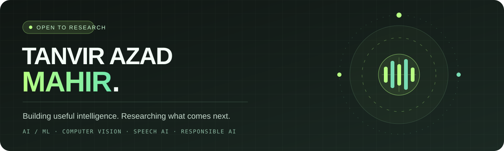

<!-- Custom animated vector banner: keep assets/hero.svg in this repository. -->
<div align="center">
  
  <br /><br />
  <a href="https://tanvirazad.pages.dev/"></a>
  <a href="https://www.linkedin.com/in/tanvir-azad-0600aa276"></a>
  <a href="mailto:tanvirazadmahir@gmail.com"></a>
  <a href="https://www.kaggle.com/tanvirazadmahir01"></a>
</div>

<br />

<table>
<tr>
<td width="60%" valign="top">

### Hello, I'm Mahir.

I'm a **Computer Science & Engineering undergraduate at United International University**, building practical systems at the intersection of **AI engineering and research**.

I like the challenging part of AI: making systems more useful, explainable and reliable outside a perfectly controlled demo.

**Currently exploring**

- Grounded, responsible **speech-to-speech conversational AI**
- **Computer vision** and handwritten text recognition
- Practical full-stack tools people can actually use

> **Build the prototype. Test the assumptions. Improve the system.**

</td>
<td width="40%" align="center" valign="middle">


<sub>From ideas → experiments → working software</sub>

</td>
</tr>
</table>

---

### Selected builds <sub> / 01 — 04</sub>

<table>
<tr>
<td width="50%" valign="top">

**01 / Handwritten Prescription Recognition**

Deep-learning handwriting recognition for medical prescriptions.

`Python` `OpenCV` `EasyOCR` `CNN` `BiLSTM` `CTC`

[Explore the repository](https://github.com/Tanvir-Azad-Mahir/handwritten_recognition_system)

</td>
<td width="50%" valign="top">

**02 / Smart Factory Safety & Navigation**

An IoT and vision-based system for environment monitoring, access control and worker rerouting.

`ESP32` `Raspberry Pi` `C/C++` `Python` `OpenCV`

[Explore the repository](https://github.com/Tanvir-Azad-Mahir/Smart-Factory)

</td>
</tr>
<tr>
<td width="50%" valign="top">

**03 / SkillSwap+**

Peer-to-peer education, mentorship, reciprocal skill exchange, messaging, WebRTC sessions, certificates and credits.

`React` `Vite` `Tailwind` `Supabase` `WebRTC`

*Repository link can be added when public.*

</td>
<td width="50%" valign="top">

**04 / Ticketron**

Railway ticket management with bookings, refunds, printable tickets and administrative tools.

`PHP` `MySQL` `JavaScript` `HTML` `CSS`

[Explore the repository](https://github.com/Tanvir-Azad-Mahir/Ticketron-A-rainway-ticket-management-system)

</td>
</tr>
</table>

---

### Research notebook <sub> / ongoing</sub>

**Grounded & Responsible Speech-to-Speech AI**

Investigating how a conversational speech system can combine retrieval, conversational context, ethical validation and interpretable decision-making to produce more trustworthy responses.

```text
SPOKEN QUESTION
      │
      ▼
  SPEECH MODEL ───► CONTEXT + RETRIEVAL
                          │
                          ▼
                   GROUNDED RESPONSE
                          │
                          ▼
                   SAFETY / VALIDATION
                          │
                          ▼
                     SPOKEN REPLY
```

<sub>Conceptual research direction — not a claim of an already-deployed end-to-end architecture.</sub>

---

### Toolkit <sub> / what I work with</sub>

<div align="center">
  
</div>

<p align="center"><code>NumPy</code> · <code>Pandas</code> · <code>Matplotlib</code> · <code>Jupyter</code> · <code>Colab</code> · <code>NLP</code> · <code>OCR</code> · <code>Transformers</code></p>

---

### GitHub activity <sub> / experiments in public</sub>

<div align="center">
  
  <br />
  
</div>

---

### Learning, credentials & next steps

- [Kaggle — Pandas certificate](https://www.kaggle.com/learn/certification/tanvirazadmahir01/pandas)
- [Kaggle — Data Visualization certificate](https://www.kaggle.com/learn/certification/tanvirazadmahir01/data-visualization)
- Exploring **retrieval-augmented speech AI**, **responsible AI**, and **interpretable intelligent systems**

<div align="center">

### Good projects start with a question.

**Have an AI research idea, open-source collaboration, or product worth building?**

[Portfolio](https://tanvirazad.pages.dev/) · [LinkedIn](https://www.linkedin.com/in/tanvir-azad-0600aa276) · [GitHub](https://github.com/Tanvir-Azad-Mahir) · [Email](mailto:tanvirazadmahir@gmail.com)


<sub>RESEARCH. BUILD. LEARN. REPEAT.</sub>

</div>
