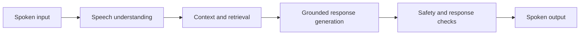

<div align="center">

<!-- HERO: animated SVG hosted by a community service -->


<a href="https://git.io/typing-svg"></a>

<br />

<a href="https://tanvirazad.pages.dev/"></a>
<a href="https://www.linkedin.com/in/tanvir-azad-0600aa276"></a>
<a href="mailto:tanvirazadmahir@gmail.com"></a>
<a href="https://www.kaggle.com/tanvirazadmahir01"></a>

<br />
<br />


</div>

<div align="center">


</div>

## `> whoami`

```yaml
name: Tanvir Azad Mahir
education: CSE Undergraduate, United International University
interests:
  - Applied AI / Machine Learning
  - Computer Vision and Handwriting Recognition
  - Natural Language Processing and Speech AI
  - Retrieval-Augmented Generation
  - Explainable and Responsible AI
mission: "Build intelligent systems that are useful, grounded, and reliable."
```

I'm a Computer Science & Engineering student who enjoys taking ideas from **research papers to working prototypes**. My interests span **machine learning, computer vision, OCR, NLP, speech AI, and responsible AI** — with an emphasis on real-world usefulness.

> **My principle:** Learn the fundamentals. Build real systems. Research what comes next.

## `> tech --stack`

<div align="center">

**Languages & application development**


**AI / ML & data**


**Workflow**


`NumPy` · `Pandas` · `Matplotlib` · `Jupyter Notebook` · `Google Colab` · `CNN` · `RNN` · `LSTM` · `BiLSTM` · `Transformers` · `CTC`

</div>

## `> ls featured-projects/`

<table>
<tr>
<td width="50%" valign="top">

### 🩺 Handwritten Prescription Recognition

Research-oriented handwriting recognition for medical prescriptions using computer vision and sequence modeling.

**Stack:** `Python` `OpenCV` `EasyOCR` `CNN` `BiLSTM` `CTC`

[**Explore repository ↗**](https://github.com/Tanvir-Azad-Mahir/handwritten_recognition_system)

</td>
<td width="50%" valign="top">

### 🏭 Smart Factory Safety & Navigation

IoT and vision-based monitoring with access control, automated gate logic, and safer worker rerouting.

**Stack:** `Python` `C/C++` `ESP32` `Raspberry Pi` `OpenCV`

[**Explore repository ↗**](https://github.com/Tanvir-Azad-Mahir/Smart-Factory)

</td>
</tr>
<tr>
<td width="50%" valign="top">

### 🚆 Ticketron

Railway ticket management with authentication, schedules, booking, refunds, tickets, and administrative tools.

**Stack:** `PHP` `MySQL` `JavaScript` `HTML` `CSS`

[**Explore repository ↗**](https://github.com/Tanvir-Azad-Mahir/Ticketron-A-rainway-ticket-management-system)

</td>
<td width="50%" valign="top">

### 🔁 SkillSwap+

Peer-to-peer learning platform connecting people through courses, mentorship, skill swaps, messaging, live sessions, and a credit system.

**Stack:** `React` `Vite` `Tailwind CSS` `Supabase` `PostgreSQL` `WebRTC`

*Project details available on request.*

</td>
</tr>
</table>

## `> research --active`

### Grounded & Responsible Speech-to-Speech AI

**Status:** In progress

Investigating a speech-to-speech conversational AI framework that explores **retrieval-grounded responses**, conversational context, ethical response validation, interpretability, and trustworthy behavior.



*Conceptual research direction; not a claim of a deployed end-to-end system.*

## `> activity --visualize`

<div align="center">


<br />

<!-- Live contribution activity visualization -->


</div>

## `> achievements --learning`

<div align="center">

<a href="https://www.kaggle.com/learn/certification/tanvirazadmahir01/pandas"></a>
<a href="https://www.kaggle.com/learn/certification/tanvirazadmahir01/data-visualization"></a>

</div>

## `> currently-exploring`

| Building | Researching |
|:--|:--|
| Practical ML and deep learning systems | Grounded speech-to-speech AI |
| Computer vision, OCR, and sequence modeling | Retrieval-augmented generation |
| Full-stack tools and collaborative platforms | Explainability and responsible AI |

## `> connect`

<div align="center">

**Interested in AI research, open source, practical experiments, or collaborative projects?**

[**Portfolio**](https://tanvirazad.pages.dev/) · [**LinkedIn**](https://www.linkedin.com/in/tanvir-azad-0600aa276) · [**Email**](mailto:tanvirazadmahir@gmail.com) · [**GitHub**](https://github.com/Tanvir-Azad-Mahir)

<br />


</div>
